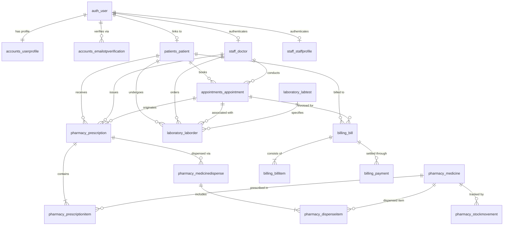

# CareFlow HMS — Database Architecture & Design Specification

## 1. System Overview
CareFlow HMS is an enterprise Hospital Management System built on Python/Django 6.1, Django REST Framework, PostgreSQL, and React. This document specifies the complete relational database architecture, entity relationships, integrity constraints, and role-based access rules.

Per strict clinical design specifications, **Bed Management (beds, wards, rooms, inpatient admissions) is completely excluded**.

---

## 2. User Roles and Permission Architecture

| Role | Database Role Code | Primary Capabilities & Workflow Rules |
| :--- | :--- | :--- |
| **Administrator** | `ADMIN` | Strictly limited to **one** administrator account across the entire system. Manages doctors and staff accounts, medicine catalogues, and system audits. **Cannot** register patients via receptionist intake, **cannot** prescribe medications or order lab tests, and **cannot** create additional administrator accounts. |
| **Receptionist** | `RECEPTIONIST` | Registers and manages patient master records, schedules appointments, and creates approved non-admin staff accounts. **Cannot** create administrator accounts. |
| **Doctor** | `DOCTOR` | Views authorized patient records and clinical appointments, authors prescriptions, and orders diagnostic laboratory tests. |
| **Laboratory Staff** | `LAB_STAFF` | Views doctor-ordered diagnostic tests, collects specimens, updates test progression status, records quantitative/qualitative results, and uploads reports. |
| **Pharmacist** | `PHARMACIST` | Manages medicine catalogue and inventory quantities, dispenses prescribed medicines, creates stock movement records, and handles dispensing payments. |
| **Patient** | `PATIENT` | Self-registers via public portal, verifies identity using 6-digit email OTP, and views their own appointments, prescriptions, lab results, and billing invoices. |

---

## 3. Database Schema & Tables

### 3.1 Module 1: Users & Authentication (`accounts`)

#### `accounts_userprofile`
Extends the standard Django `auth_user` model.
- `id` (BigInt, PK)
- `user_id` (Integer, FK -> `auth_user.id`, 1:1, Unique, On Delete CASCADE)
- `role` (Varchar(20), choices: `ADMIN`, `DOCTOR`, `RECEPTIONIST`, `LAB_STAFF`, `PHARMACIST`, `PATIENT`, Default `PATIENT`, Indexed)
- `phone_number` (Varchar(25), Nullable)
- `is_email_verified` (Boolean, Default False)
- `created_at` (Timestamp with time zone)
- `updated_at` (Timestamp with time zone)
- *Constraint*: Application and database validations strictly restrict `role = 'ADMIN'` to exactly one user.

#### `accounts_emailotpverification`
Maintains cryptographically secure 6-digit OTP codes for patient self-registration and verification.
- `id` (BigInt, PK)
- `email` (EmailField, Indexed)
- `user_id` (Integer, FK -> `auth_user.id`, Nullable, On Delete CASCADE)
- `otp_code` (Varchar(6))
- `purpose` (Varchar(30), choices: `registration`, `login`, `password_reset`)
- `attempts` (Integer, Default 0, Max 5 attempts)
- `is_verified` (Boolean, Default False)
- `created_at` (Timestamp with time zone)
- `expires_at` (Timestamp with time zone, 10 min window)
- *Indexes*: Composite index on `(email, purpose, is_verified)`.

---

### 3.2 Module 2: Patient Management (`patients`)

#### `patients_patient`
Master clinical registry of patients.
- `id` (BigInt, PK)
- `patient_id` (Varchar(20), Unique, Indexed, format `CF-P-XXXXX`)
- `user_id` (Integer, FK -> `auth_user.id`, 1:1, Nullable, On Delete SET_NULL)
- `first_name` (Varchar(100))
- `last_name` (Varchar(100))
- `date_of_birth` (Date, Nullable)
- `gender` (Varchar(10), choices: `MALE`, `FEMALE`, `OTHER`)
- `blood_group` (Varchar(5), choices: `A+`, `A-`, `B+`, `B-`, `AB+`, `AB-`, `O+`, `O-`, Nullable)
- `phone_number` (Varchar(25), Indexed)
- `email` (EmailField, Nullable)
- `address` (Text, Nullable)
- `emergency_contact_name` (Varchar(150), Nullable)
- `emergency_contact_phone` (Varchar(25), Nullable)
- `emergency_contact_relation` (Varchar(50), Nullable)
- `medical_history` (Text, Nullable)
- `allergies` (Text, Nullable)
- `registration_date` (Date, Default localdate, Indexed)
- `is_active` (Boolean, Default True)
- `created_at` (Timestamp with time zone)
- `updated_at` (Timestamp with time zone)
- *Indexes*: Composite index on `(last_name, first_name)`, index on `phone_number`, index on `patient_id`.

---

### 3.3 Module 3: Doctor and Staff Management (`staff`)

#### `staff_doctor`
Clinical doctor profiles linked to doctor user accounts.
- `id` (BigInt, PK)
- `doctor_id` (Varchar(20), Unique, Indexed, format `CF-DOC-XXX`)
- `user_id` (Integer, FK -> `auth_user.id`, 1:1, On Delete CASCADE)
- `first_name` (Varchar(100))
- `last_name` (Varchar(100))
- `specialization` (Varchar(100), Indexed)
- `qualification` (Varchar(150))
- `license_number` (Varchar(50), Unique)
- `department` (Varchar(100))
- `phone_number` (Varchar(25))
- `email` (EmailField)
- `consultation_fee` (Decimal(10, 2), Default 500.00)
- `available_days` (Varchar(120))
- `start_time` (Time, Default 09:00:00)
- `end_time` (Time, Default 17:00:00)
- `status` (Varchar(20), choices: `ACTIVE`, `ON_LEAVE`, `INACTIVE`, Indexed)
- `created_at` (Timestamp with time zone)
- `updated_at` (Timestamp with time zone)

#### `staff_staffprofile`
Healthcare staff profiles for receptionists, lab technicians, and pharmacists.
- `id` (BigInt, PK)
- `staff_id` (Varchar(20), Unique, Indexed, format `CF-STF-XXX`)
- `user_id` (Integer, FK -> `auth_user.id`, 1:1, On Delete CASCADE)
- `first_name` (Varchar(100))
- `last_name` (Varchar(100))
- `role` (Varchar(20), choices: `RECEPTIONIST`, `LAB_STAFF`, `PHARMACIST`, Indexed)
- `department` (Varchar(100))
- `qualification` (Varchar(150), Nullable)
- `phone_number` (Varchar(25))
- `email` (EmailField)
- `status` (Varchar(20), choices: `ACTIVE`, `INACTIVE`, Indexed)
- `created_at` (Timestamp with time zone)
- `updated_at` (Timestamp with time zone)

---

### 3.4 Module 4: Appointment Management (`appointments`)

#### `appointments_appointment`
Clinical consultation appointments between patients and doctors.
- `id` (BigInt, PK)
- `appointment_id` (Varchar(20), Unique, Indexed, format `CF-APT-XXXXX`)
- `patient_id` (BigInt, FK -> `patients_patient.id`, On Delete PROTECT)
- `doctor_id` (BigInt, FK -> `staff_doctor.id`, On Delete PROTECT)
- `appointment_date` (Date, Indexed)
- `appointment_time` (Time)
- `status` (Varchar(20), choices: `SCHEDULED`, `CONFIRMED`, `IN_PROGRESS`, `COMPLETED`, `CANCELLED`, `NO_SHOW`, Indexed)
- `reason_for_visit` (Text)
- `authorized_notes` (Text, Nullable)
- `created_by_id` (Integer, FK -> `auth_user.id`, Nullable, On Delete SET_NULL)
- `created_at` (Timestamp with time zone)
- `updated_at` (Timestamp with time zone)
- *Unique Constraint*: `unique_doctor_active_appointment_slot` on `(doctor, appointment_date, appointment_time)` where `status != 'CANCELLED'`. Prevents double-booking.

---

### 3.5 Module 5: Prescriptions and Medicine Management (`pharmacy`)

#### `pharmacy_medicine`
Pharmaceutical catalogue and real-time inventory ledger.
- `id` (BigInt, PK)
- `medicine_code` (Varchar(20), Unique, Indexed, format `MED-XXXX`)
- `name` (Varchar(200), Indexed)
- `generic_name` (Varchar(200), Nullable)
- `brand_name` (Varchar(200), Nullable)
- `dosage_form` (Varchar(30), choices: `TABLET`, `CAPSULE`, `SYRUP`, `INJECTION`, `OINTMENT`, `DROPS`, `INHALER`, `OTHER`)
- `strength` (Varchar(50), Nullable)
- `unit_price` (Decimal(10, 2))
- `stock_quantity` (Integer, Default 0)
- `reorder_level` (Integer, Default 10)
- `manufacturer` (Varchar(150), Nullable)
- `batch_number` (Varchar(50), Nullable)
- `expiry_date` (Date, Nullable)
- `is_active` (Boolean, Default True)
- `created_at` (Timestamp with time zone)
- `updated_at` (Timestamp with time zone)
- *Check Constraints*:
  - `medicine_stock_non_negative`: `stock_quantity >= 0` (Blocks negative inventory).
  - `medicine_unit_price_non_negative`: `unit_price >= 0`.

#### `pharmacy_stockmovement`
Immutable stock audit ledger recording every inventory transaction.
- `id` (BigInt, PK)
- `movement_id` (Varchar(25), Unique, Indexed, format `STK-XXXXX`)
- `medicine_id` (BigInt, FK -> `pharmacy_medicine.id`, On Delete PROTECT)
- `movement_type` (Varchar(25), choices: `PURCHASE_IN`, `DISPENSED_OUT`, `ADJUSTMENT_IN`, `ADJUSTMENT_OUT`, `RETURN_IN`, `EXPIRED_OUT`)
- `quantity` (PositiveInteger)
- `previous_stock` (Integer)
- `new_stock` (Integer)
- `reference_note` (Varchar(255), Nullable)
- `performed_by_id` (Integer, FK -> `auth_user.id`, On Delete PROTECT)
- `created_at` (Timestamp with time zone)

#### `pharmacy_prescription`
Doctor prescription records.
- `id` (BigInt, PK)
- `prescription_id` (Varchar(20), Unique, Indexed, format `CF-RX-XXXXX`)
- `patient_id` (BigInt, FK -> `patients_patient.id`, On Delete PROTECT)
- `doctor_id` (BigInt, FK -> `staff_doctor.id`, On Delete PROTECT)
- `appointment_id` (BigInt, FK -> `appointments_appointment.id`, Nullable, On Delete SET_NULL)
- `diagnosis` (Text)
- `clinical_notes` (Text, Nullable)
- `status` (Varchar(25), choices: `PENDING`, `PARTIALLY_DISPENSED`, `DISPENSED`, `CANCELLED`, Indexed)
- `created_at` (Timestamp with time zone)
- `updated_at` (Timestamp with time zone)

#### `pharmacy_prescriptionitem`
Individual medicine line items in a prescription.
- `id` (BigInt, PK)
- `prescription_id` (BigInt, FK -> `pharmacy_prescription.id`, On Delete CASCADE)
- `medicine_id` (BigInt, FK -> `pharmacy_medicine.id`, On Delete PROTECT)
- `dosage` (Varchar(100))
- `frequency` (Varchar(100))
- `duration` (Varchar(100))
- `quantity_prescribed` (PositiveInteger)
- `quantity_dispensed` (PositiveInteger, Default 0)
- `instructions` (Text, Nullable)
- `is_dispensed` (Boolean, Default False)
- `created_at` (Timestamp with time zone)
- *Check Constraints*:
  - `rx_item_qty_prescribed_positive`: `quantity_prescribed > 0`
  - `rx_item_dispensed_lte_prescribed`: `quantity_dispensed <= quantity_prescribed`

#### `pharmacy_medicinedispense`
Dispensing events performed by authorized pharmacists.
- `id` (BigInt, PK)
- `dispense_id` (Varchar(20), Unique, Indexed, format `CF-DSP-XXXXX`)
- `prescription_id` (BigInt, FK -> `pharmacy_prescription.id`, On Delete PROTECT)
- `patient_id` (BigInt, FK -> `patients_patient.id`, On Delete PROTECT)
- `dispensed_by_id` (Integer, FK -> `auth_user.id`, On Delete PROTECT)
- `total_amount` (Decimal(10, 2), Default 0.00)
- `notes` (Text, Nullable)
- `dispensed_at` (Timestamp with time zone)

#### `pharmacy_dispenseitem`
Specific medicines and quantities dispensed in a dispensing event.
- `id` (BigInt, PK)
- `dispense_id` (BigInt, FK -> `pharmacy_medicinedispense.id`, On Delete CASCADE)
- `prescription_item_id` (BigInt, FK -> `pharmacy_prescriptionitem.id`, On Delete PROTECT)
- `medicine_id` (BigInt, FK -> `pharmacy_medicine.id`, On Delete PROTECT)
- `quantity` (PositiveInteger)
- `unit_price` (Decimal(10, 2))
- `subtotal` (Decimal(10, 2))
- *Check Constraints*: `quantity > 0` and `subtotal >= 0`.

---

### 3.6 Module 6: Laboratory Management (`laboratory`)

#### `laboratory_labtest`
Catalogue of clinical diagnostic tests.
- `id` (BigInt, PK)
- `test_code` (Varchar(20), Unique, Indexed, format `LAB-XXX`)
- `test_name` (Varchar(200), Indexed)
- `category` (Varchar(50), choices: `HEMATOLOGY`, `BIOCHEMISTRY`, `MICROBIOLOGY`, `PATHOLOGY`, `RADIOLOGY`, `IMMUNOLOGY`, `URINALYSIS`, `OTHER`, Indexed)
- `description` (Text, Nullable)
- `price` (Decimal(10, 2))
- `reference_range` (Varchar(200), Nullable)
- `unit` (Varchar(50), Nullable)
- `turnaround_time` (Varchar(50), Nullable)
- `is_active` (Boolean, Default True)
- `created_at` (Timestamp with time zone)
- `updated_at` (Timestamp with time zone)
- *Check Constraint*: `lab_test_price_non_negative`: `price >= 0`.

#### `laboratory_laborder`
Diagnostic tests ordered by doctors for patients.
- `id` (BigInt, PK)
- `order_id` (Varchar(20), Unique, Indexed, format `CF-LAB-XXXXX`)
- `patient_id` (BigInt, FK -> `patients_patient.id`, On Delete PROTECT)
- `doctor_id` (BigInt, FK -> `staff_doctor.id`, On Delete PROTECT)
- `appointment_id` (BigInt, FK -> `appointments_appointment.id`, Nullable, On Delete SET_NULL)
- `test_id` (BigInt, FK -> `laboratory_labtest.id`, On Delete PROTECT)
- `status` (Varchar(25), choices: `ORDERED`, `SAMPLE_COLLECTED`, `IN_PROGRESS`, `COMPLETED`, `CANCELLED`, Indexed)
- `clinical_notes` (Text, Nullable)
- `assigned_staff_id` (Integer, FK -> `auth_user.id`, Nullable, On Delete SET_NULL)
- `result_value` (Varchar(255), Nullable)
- `result_notes` (Text, Nullable)
- `reference_range_used` (Varchar(200), Nullable)
- `report_file` (Varchar(100), Nullable, uploaded file path in media)
- `ordered_at` (Timestamp with time zone)
- `sample_collected_at` (Timestamp with time zone, Nullable)
- `completed_at` (Timestamp with time zone, Nullable)
- `updated_at` (Timestamp with time zone)

---

### 3.7 Module 7: Billing & Payments (`billing`)

#### `billing_bill`
Financial invoices generated for outpatient visits, diagnostics, and medications.
- `id` (BigInt, PK)
- `bill_number` (Varchar(25), Unique, Indexed, format `CF-INV-XXXXX`)
- `patient_id` (BigInt, FK -> `patients_patient.id`, On Delete PROTECT)
- `appointment_id` (BigInt, FK -> `appointments_appointment.id`, Nullable, On Delete SET_NULL)
- `total_amount` (Decimal(12, 2), Default 0.00)
- `discount_amount` (Decimal(12, 2), Default 0.00)
- `net_amount` (Decimal(12, 2), Default 0.00)
- `paid_amount` (Decimal(12, 2), Default 0.00)
- `balance_due` (Decimal(12, 2), Default 0.00)
- `status` (Varchar(20), choices: `UNPAID`, `PARTIALLY_PAID`, `PAID`, `CANCELLED`, Indexed)
- `due_date` (Date, Nullable)
- `notes` (Text, Nullable)
- `created_by_id` (Integer, FK -> `auth_user.id`, On Delete PROTECT)
- `created_at` (Timestamp with time zone)
- `updated_at` (Timestamp with time zone)
- *Check Constraints*:
  - `bill_total_non_negative`: `total_amount >= 0`
  - `bill_discount_non_negative`: `discount_amount >= 0`
  - `bill_paid_non_negative`: `paid_amount >= 0`
  - `bill_balance_non_negative`: `balance_due >= 0`

#### `billing_billitem`
Individual charge line items within an invoice.
- `id` (BigInt, PK)
- `bill_id` (BigInt, FK -> `billing_bill.id`, On Delete CASCADE)
- `item_type` (Varchar(25), choices: `CONSULTATION`, `MEDICINE`, `LAB_TEST`, `PROCEDURE`, `OTHER`)
- `description` (Varchar(255))
- `quantity` (PositiveInteger, Default 1)
- `unit_price` (Decimal(10, 2))
- `subtotal` (Decimal(10, 2))
- `reference_id` (Varchar(50), Nullable, e.g. lab order id or prescription dispense id)
- `created_at` (Timestamp with time zone)
- *Check Constraints*: `quantity > 0` and `subtotal >= 0`.

#### `billing_payment`
Financial payment receipts recorded against patient invoices.
- `id` (BigInt, PK)
- `receipt_number` (Varchar(25), Unique, Indexed, format `CF-RCP-XXXXX`)
- `bill_id` (BigInt, FK -> `billing_bill.id`, On Delete PROTECT)
- `amount` (Decimal(12, 2))
- `payment_method` (Varchar(20), choices: `CASH`, `CARD`, `UPI`, `NET_BANKING`, `INSURANCE`)
- `status` (Varchar(20), choices: `SUCCESS`, `FAILED`, `REFUNDED`, Indexed)
- `transaction_reference` (Varchar(100), Nullable, Unique)
- `received_by_id` (Integer, FK -> `auth_user.id`, On Delete PROTECT)
- `payment_date` (Timestamp with time zone)
- `notes` (Text, Nullable)
- *Check Constraint*: `payment_amount_positive`: `amount > 0`.
- *Transactional Behavior*: Automatically and atomically updates parent `Bill.paid_amount`, `Bill.balance_due`, and `Bill.status`.

---

## 4. Entity-Relationship Diagram (ERD)

---

## 5. Data Integrity, Foreign Key Protection & Safety Rules

1. **Deletion Protection**: Critical clinical and financial relationships (`patients.Patient`, `staff.Doctor`, `pharmacy.Medicine`, `pharmacy.Prescription`, `billing.Bill`) use `models.PROTECT`. This prevents cascading deletion of clinical histories, financial records, or medical catalogues.
2. **Atomic Financial Updates**: All bill payments execute within database transactions (`transaction.atomic()`). Successful transactions dynamically recalculate paid amounts and remaining balances, preventing discrepancy bugs or race conditions.
3. **Atomic Pharmacy Dispensing**: Dispensing decrements stock within a `select_for_update()` transaction, writes an immutable `StockMovement` ledger entry, and rejects requests exceeding available stock.
4. **Single-Admin System Rule**: Strictly enforces a single administrator account in `UserProfile` model clean/save methods, database constraints, and API serializer validations.
5. **Separation of Duties**:
   - Only Receptionists can register patients via clinical intake.
   - Only Doctors can prescribe medications and order diagnostic lab tests.
   - Only Pharmacists can dispense medications.
   - Only Lab Staff can update diagnostic test results and upload reports.
